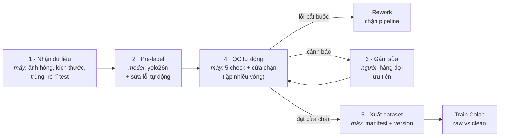

# Day 09 Lab — Pipeline kiểm nhãn tự động

**Bài cá nhân · 4–5 giờ (train Colab chạy nền trong lúc bạn viết báo cáo) · Python · dữ liệu 4 lớp xe/người · model yolo26n**

Bạn nhận một lô **224 ảnh** đã có nhãn (do **yolo26n** pre-label rồi qua tay một vòng gán/sửa cẩu thả). Trong lô có đủ loại lỗi:
ảnh hỏng, ảnh trùng, ảnh rò rỉ từ tập test, file nhãn mất, ID lớp sai, box tràn ảnh, box lỏng, thiếu nhãn, gán nhầm lớp…
Việc của bạn là **xây một pipeline tự động** — một lệnh chạy từ ảnh thô đến bộ dữ liệu sạch — rồi **chứng minh bằng thí nghiệm**
(train trên Google Colab) rằng dữ liệu sau pipeline cho model tốt hơn dữ liệu gốc.



Bạn sẽ **tự viết 9 mảnh code** (7 module check + `autofix` + `gate`, xem [GUIDE.md](GUIDE.md)); phần còn lại
(orchestrator, pre-label, người duyệt mô phỏng, xuất, train) đã có sẵn để bạn tập trung vào **kiểm tra chất lượng nhãn**.

## Bắt đầu

```bash
# 1) Mở https://github.com/Haiduongcable/L23-Day09-AutoQC-Pipeline-Lab → nút "Use this template" → repo PUBLIC của bạn (Colab cần public)
git clone <repo của bạn>
cd <repo>
python -m venv .venv
source .venv/bin/activate           # Windows: .venv\Scripts\activate
pip install -r requirements.txt      # nhẹ, KHÔNG cần torch; chỉ khi train cục bộ mới cần requirements-train.txt
python -m pytest -q                 # lúc đầu: đỏ hết (61 failed). Mục tiêu: xanh hết.
```

> Windows: không có `make` → chạy thẳng các lệnh `python ...` trong [Makefile](Makefile); đặt `set PYTHONUTF8=1` (PowerShell: `$env:PYTHONUTF8=1`) trước khi chạy để ghi tiếng Việt đúng.
> Mã thoát của `python -m pipeline.run`: 0 Release · 10 Hold · 20 Rework · 30 tạm dừng chờ người duyệt (PowerShell: `$LASTEXITCODE`).

1. Đọc **[GUIDE.md](GUIDE.md)** (từng pha, lệnh chạy, bẫy hay gặp) và **[RULES.md](RULES.md)**.
2. Làm theo thứ tự: unit test xanh → `make calibrate` → `make run` → Colab → viết báo cáo → `make check` → nộp.
3. Chấm điểm: [RUBRIC.md](RUBRIC.md) (100 điểm). Cách nộp: [SUBMISSION.md](SUBMISSION.md).

> **Khi nộp:** đổi dòng tiêu đề này thành `# Day 09 Lab — <Họ và tên>: <MSHV> - <Họ và tên>`.

## Bạn sẽ có gì sau bài này

| Sản phẩm | Ở đâu |
|---|---|
| Bộ kiểm tự động (7 check + sửa tự động + cửa chặn), unit test xanh | `pipeline/`, `tests/` |
| **Danh sách lỗi** trước / sau sửa / sau người duyệt, log các thay đổi, hàng đợi người duyệt | `submission/reports/` |
| **Kết quả calibration**: precision/recall của công cụ, ngưỡng đã chọn và lý do | `submission/calibration/` |
| Dataset đã xuất + `manifest.json` (truy vết) | `submission/export/clean_v1/` |
| **So sánh train**: raw vs clean (nhiều seed), phân tích trung thực | `submission/results/` |
| Báo cáo tóm tắt + quyết định Release/Hold/Rework | `submission/REPORT.md` |

## Tài liệu

| Bạn cần | Xem |
|---|---|
| Các pha làm việc, lệnh, mốc giờ | [GUIDE.md](GUIDE.md), [CHECKPOINTS.md](CHECKPOINTS.md) |
| Quy tắc, dùng AI | [RULES.md](RULES.md) |
| Chấm điểm | [RUBRIC.md](RUBRIC.md) |
| Nộp bài | [SUBMISSION.md](SUBMISSION.md) |
| Dữ liệu, 22 mã lỗi, nguồn ảnh | [data/README.md](data/README.md) |
| Kiến trúc pipeline, vào/ra từng bước | [docs/PIPELINE.md](docs/PIPELINE.md) |
| Calibration là gì, đọc bảng sweep | [docs/CALIBRATION.md](docs/CALIBRATION.md) |
| Prompt AI viết script (4 ý), kiểm code AI | [docs/PROMPTING.md](docs/PROMPTING.md) |
| Lọc box nhỏ trong CVAT (tuỳ chọn) | [docs/CVAT_FILTER.md](docs/CVAT_FILTER.md) |
| Notebook Colab | [notebooks/day09_train_compare.ipynb](notebooks/day09_train_compare.ipynb) |

Slide tham khảo: **Day 09 — Công cụ kiểm tự động & Pipeline cơ bản**. Nền tảng: Day 07 (QC, Release/Hold/Rework), Day 08 (pre-label).
