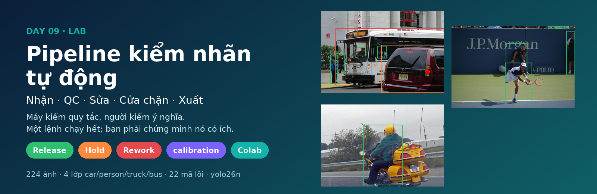
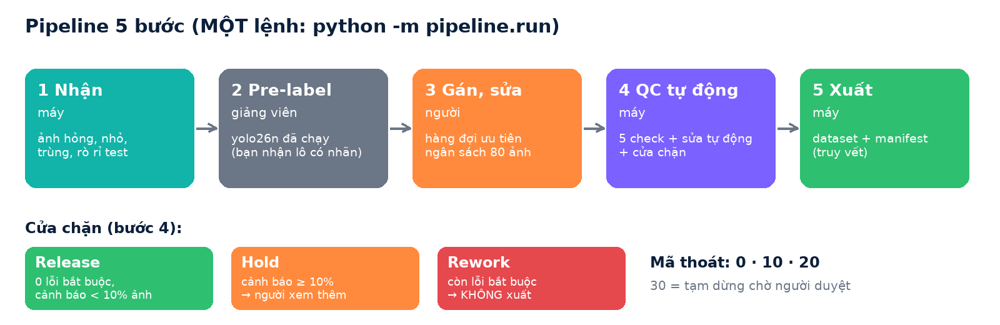
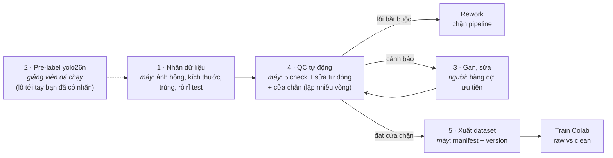
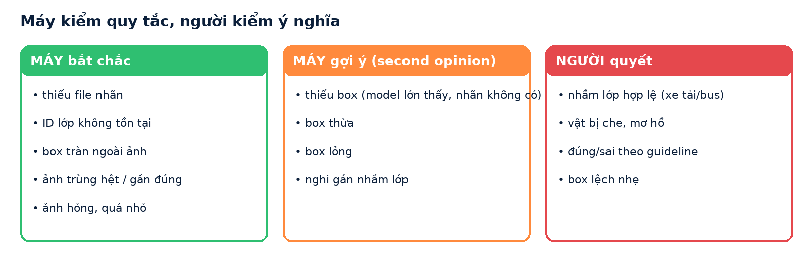
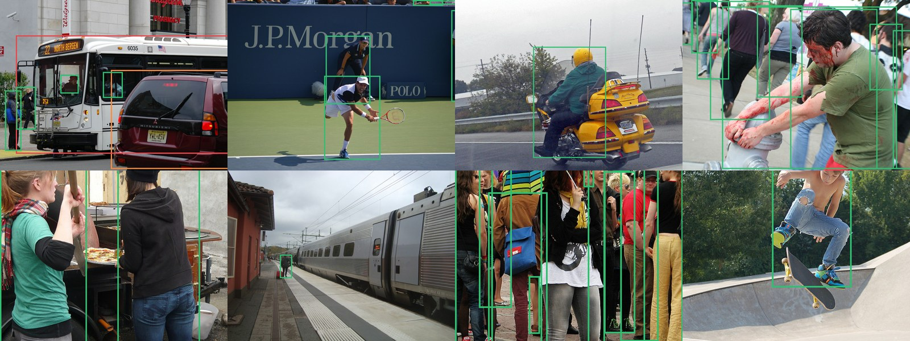

  

# Day 09 Lab — Pipeline kiểm nhãn tự động

  
  
  
  
  
  

> **Máy kiểm quy tắc, người kiểm ý nghĩa.** Bạn xây một pipeline chạy bằng MỘT lệnh, rồi **chứng minh** (số liệu, trung thực) nó có ích.

Bạn nhận một lô **224 ảnh** đã được gán nhãn sẵn (giảng viên chạy **yolo26n** để pre-label, rồi qua một vòng gán/sửa cẩu thả — bạn **không** chạy model này). Trong lô có đủ loại lỗi:
ảnh hỏng, ảnh trùng, ảnh rò rỉ từ tập test, file nhãn mất, ID lớp sai, box tràn ảnh, box lỏng, thiếu nhãn, gán nhầm lớp…
Việc của bạn là **xây một pipeline tự động** — một lệnh chạy từ ảnh thô đến bộ dữ liệu sạch — rồi **chứng minh bằng thí nghiệm**
(train trên Google Colab) rằng dữ liệu sau pipeline cho model tốt hơn dữ liệu gốc.

<b>Sơ đồ chi tiết (mermaid)</b>

## Bộ dữ liệu

224 ảnh COCO val2017 (CC BY 4.0; xem [data/ATTRIBUTION.csv](data/ATTRIBUTION.csv)): **raw 224** (cần QC) · **calib 39** (có đáp án lỗi, để chọn ngưỡng) · **gold_val 40** · **test 100** (chỉ để đo cuối). Chi tiết: [data/README.md](data/README.md).

Bạn sẽ **tự viết 9 mảnh code** (7 module check + `autofix` + `gate`, xem [GUIDE.md](GUIDE.md)); phần còn lại
(orchestrator, người duyệt mô phỏng, xuất, train) đã có sẵn để bạn tập trung vào **kiểm tra chất lượng nhãn**.

## Bắt đầu nhanh (6 bước)

1. Mở https://github.com/Haiduongcable/L23-Day09-AutoQC-Pipeline-Lab → **Use this template** → repo **public** của bạn (tên: xem [SUBMISSION.md](SUBMISSION.md)), rồi `git clone`.
2. Cài môi trường: [docs/SETUP.md](docs/SETUP.md) → `python -m pytest -q` ra **64 failed** (đúng dự kiến).
3. Đọc [GUIDE.md](GUIDE.md) và [RULES.md](RULES.md); làm theo thứ tự: unit test xanh → `make calibrate` → `make run`.
4. (Bản nhẹ bắt buộc) Lọc box nhỏ trong CVAT: [docs/CVAT_FILTER.md](docs/CVAT_FILTER.md), nhãn dự án ở [cvat/labels.json](cvat/labels.json).
5. Train trên Colab: [docs/COLAB.md](docs/COLAB.md), rồi viết báo cáo.
6. `python scripts/check_submission.py` hết LỖI → nộp.

> **Khi nộp:** đổi dòng tiêu đề README thành `# Day 09 Lab — <Họ và tên>: <MSHV> - <Họ và tên>`.
> Windows không có `make`: chạy thẳng lệnh `python ...` trong [Makefile](Makefile). Mã thoát `python -m pipeline.run`: 0 Release · 10 Hold · 20 Rework · 30 tạm dừng chờ người duyệt.

<b>Vì sao cổng Hold ở 10% và ngân sách duyệt chỉ 80 ảnh?</b>

Slide ví dụ ngưỡng 2% ("dự án đặt trong guideline"). Ở lab, hàng đợi người duyệt có 80 ảnh trên ~200 ảnh nên chọn 10%. Ảnh chưa duyệt vẫn tính vào tỉ lệ cảnh báo: ngân sách không đủ thì **không** được Release. Xem [GUIDE.md](GUIDE.md).

<b>Máy yếu / Windows / không GPU?</b>

- Không cần GPU cho pipeline: chỉ train mới cần ([Colab](docs/COLAB.md) hoặc Kaggle).
- Windows: dùng Git Bash/WSL chạy nguyên lệnh `make`, hoặc chạy trực tiếp lệnh `python` (đặt `PYTHONUTF8=1`).
- Không có CVAT: ghi rõ lý do và thay bằng script (xem [CVAT_FILTER.md](docs/CVAT_FILTER.md)).

## Bạn sẽ có gì sau bài này

| Sản phẩm | Ở đâu |
|---|---|
| Bộ kiểm tự động (7 check + sửa tự động + cửa chặn), unit test xanh | `pipeline/`, `tests/` |
| **Danh sách lỗi** trước / sau sửa / sau người duyệt, log các thay đổi, hàng đợi người duyệt | `submission/reports/` |
| **Kết quả calibration**: precision/recall của công cụ, ngưỡng đã chọn và lý do | `submission/calibration/` |
| Dataset đã xuất + `manifest.json` (truy vết) | `submission/export/clean_v1/` |
| **So sánh train**: raw vs clean (nhiều seed), phân tích trung thực | `submission/results/` |
| Báo cáo tóm tắt + quyết định Release/Hold/Rework | `submission/REPORT.md` |

## Tài liệu

| Bạn cần | Xem |
|---|---|
| Các pha làm việc, lệnh, mốc giờ | [GUIDE.md](GUIDE.md), [CHECKPOINTS.md](CHECKPOINTS.md) |
| Quy tắc, dùng AI | [RULES.md](RULES.md) |
| Chấm điểm | [RUBRIC.md](RUBRIC.md) |
| Nộp bài | [SUBMISSION.md](SUBMISSION.md) |
| Dữ liệu, 22 mã lỗi, nguồn ảnh | [data/README.md](data/README.md) |
| Kiến trúc pipeline, vào/ra từng bước | [docs/PIPELINE.md](docs/PIPELINE.md) |
| Calibration là gì, đọc bảng sweep | [docs/CALIBRATION.md](docs/CALIBRATION.md) |
| Prompt AI viết script (4 ý), kiểm code AI | [docs/PROMPTING.md](docs/PROMPTING.md) |
| Lọc box nhỏ trong CVAT (bản nhẹ bắt buộc) | [docs/CVAT_FILTER.md](docs/CVAT_FILTER.md) |
| Cài đặt môi trường | [docs/SETUP.md](docs/SETUP.md) |
| Train trên Colab | [docs/COLAB.md](docs/COLAB.md), [notebooks/day09_train_compare.ipynb](notebooks/day09_train_compare.ipynb) |
| Nhãn dự án cho CVAT | [cvat/labels.json](cvat/labels.json) |

Slide tham khảo: **Day 09 — Công cụ kiểm tự động & Pipeline cơ bản**. Nền tảng: Day 07 (QC, Release/Hold/Rework), Day 08 (pre-label).

## Bạn học được gì

- Chia việc đúng: **máy** kiểm quy tắc (thiếu nhãn, ID, tràn ảnh, trùng), **người** kiểm ý nghĩa.
- Viết check có **test**, nối thành pipeline một lệnh với **cửa chặn** Release / Hold / Rework và mã thoát cho CI.
- **Calibration**: chọn ngưỡng bằng bộ calib có đáp án, nhận ra khi tối ưu cho calib mà hại dữ liệu thật.
- Thí nghiệm train công bằng và **kết luận trung thực** khi chênh lệch nằm trong nhiễu.

Hình trong `docs/assets/` do giảng viên vẽ bằng `docs/assets/make_figures.py`; ảnh mẫu từ COCO val2017 (CC BY 4.0).
